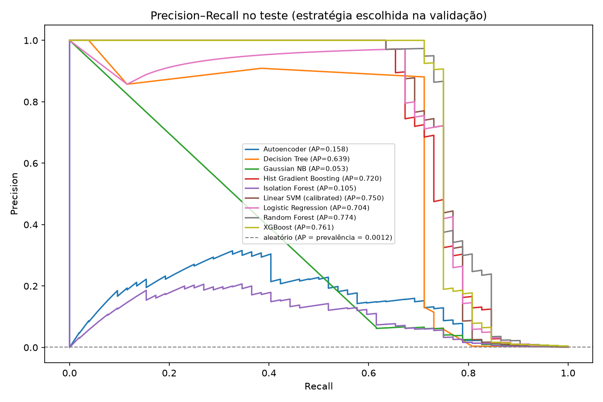
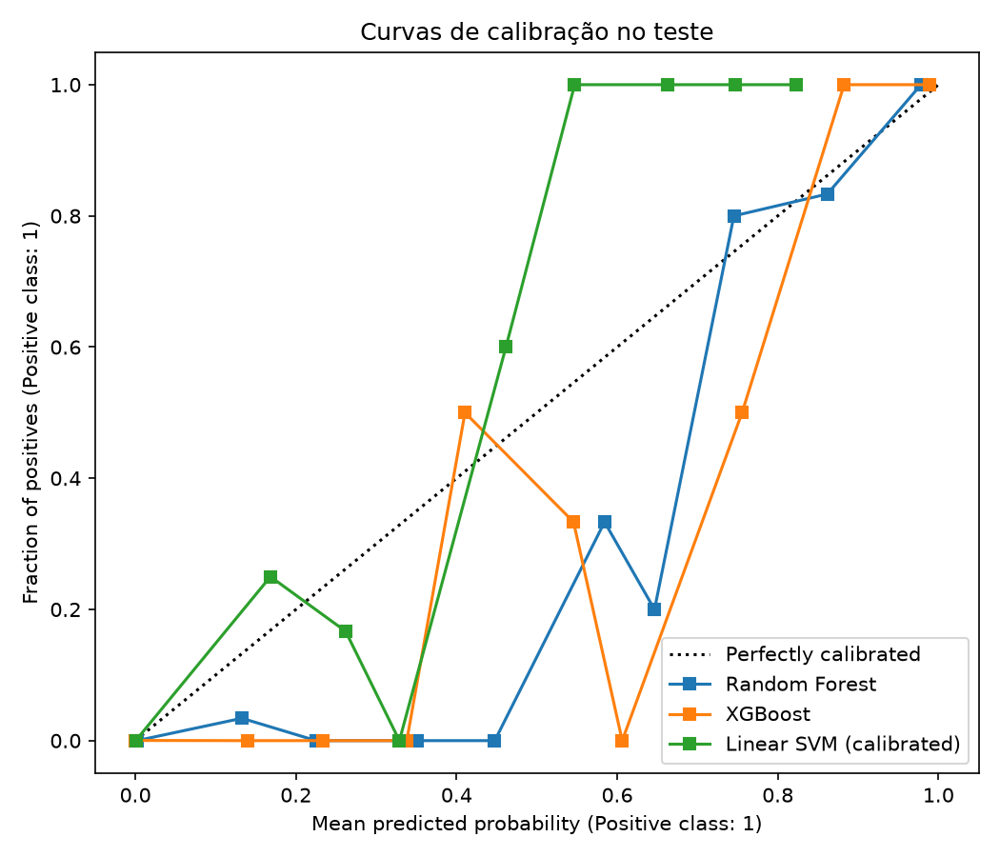
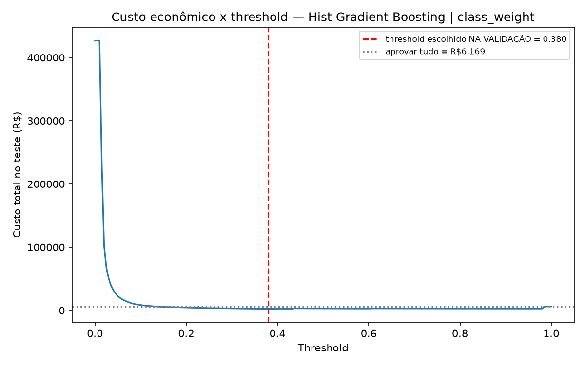
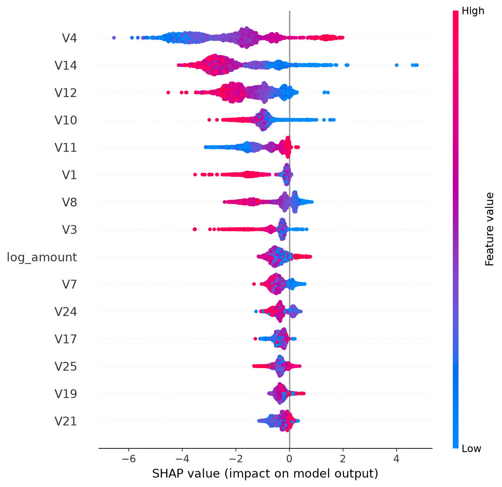

<div align="center">

# Credit Card Fraud Detection: From Academic Monograph to Production ML Benchmark

[](https://www.python.org/)
[](https://scikit-learn.org/)
[](https://xgboost.readthedocs.io/)
[](https://opensource.org/licenses/MIT)
[]()

**A rigorous comparative benchmark addressing data leakage, concept drift, probability calibration, cost-sensitive decision theory, and statistical hypothesis testing in financial fraud detection.**

*Author:* **Vinicius Dias Oliveira**  
*Academic Affiliation:* Escola Paulista de Política, Economia e Negócios (EPPEN) — Universidade Federal de São Paulo (UNIFESP)

</div>

---

## 📌 Executive Summary

Detecting credit card fraud is a classic extreme class imbalance problem: in the canonical **Dal Pozzolo et al. (ULB/Kaggle)** dataset, only **492 out of 284,807 transactions are fraudulent (0.172%)**.

Most public repositories evaluate this dataset naively: shuffling data across time, reporting deceptive `ROC-AUC > 0.99`, tuning decision thresholds directly on the test set, and applying SMOTE blindly.

This repository documents the evolution of this project across two distinct phases:
1. **Version 1.0 (2025 Monograph / Undergraduate Thesis):** The original academic investigation exploring classical classifiers (Logistic Regression, LinearSVM, Decision Trees) and F1-score maximization.
2. **Version 2.1 (Production-Grade State-of-the-Art Benchmark):** A complete methodological overhaul correcting **10 foundational methodological flaws**, introducing **out-of-time chronological validation**, **ablation studies**, **Platt probability calibration**, **example-dependent economic cost minimization in R$**, **multi-seed algorithmic variance**, **stratified bootstrap confidence intervals**, **paired McNemar significance tests**, **XGBoost tuning**, **unsupervised anomaly detection**, and **SHAP explainability**.

---

## 🔬 What Changed: v1.0 (Monograph) vs. v2.1 (State of the Art)

The table below contrasts the original monograph implementation with the revised production pipeline:

| # | Methodological Dimension | v1.0 (Original Monograph) | v2.1 (Production Benchmark) | Theoretical Rationale & Literature |
|:-:|:---|:---|:---|:---|
| **1** | **Selection Leakage** | Threshold tuned on the **test set** to maximize F1 (optimism bias). | Thresholds tuned **strictly on validation** and frozen before test evaluation. | Prevents model assessment selection bias (*Cawley & Talbot, JMLR 2010*). |
| **2** | **Temporal Integrity** | Random shuffle split; time feature treated statically or dropped. | **Out-of-time chronological split (70/15/15)**; cyclical `hour` feature extracted. | Mimics production deployment under concept drift (*Dal Pozzolo, 2015*). |
| **3** | **Ablation Protocol** | `class_weight='balanced'` always enabled simultaneously with SMOTE. | **Strict 1-factor ablation**: `baseline` vs. `class_weight` vs. `smote` inside pipeline. | Identifies true isolated marginal contributions (*He & Garcia, 2009*). |
| **4** | **Evaluation Metric** | Headline emphasis on ROC-AUC under 0.17% fraud prevalence. | **PR-AUC (Average Precision)** as primary metric; baseline = 0.0017. | ROC-AUC severely underestimates False Positive burden (*Saito & Rehmsmeier, 2015*). |
| **5** | **Business Objective** | Symmetric F1-score (weights False Positives and False Negatives 1:1). | **Expected Economic Cost in R$** ($C_{FN} = Amount$, $C_{FP} = R\$ 10$ review cost). | Connects transaction cost economics with Bayesian decision theory (*Elkan, 2001; Bahnsen et al., 2014*). |
| **6** | **Score Calibration** | LinearSVC margin distances (`decision_function`) used as pseudo-probabilities. | **Platt Sigmoid Scaling** via `CalibratedClassifierCV(cv=3)` + Brier score. | Uncalibrated scores invalidate cost-optimal decision boundaries (*Platt, 1999*). |
| **7** | **Inference & Uncertainty** | 1 split, 1 seed, single-point estimates with zero dispersion reported. | **5 seeds** (algorithmic variance) + **Bootstrap 95% CI** (sampling variance). | Quantifies classifier instability and statistical significance (*Dietterich, 1998; Efron & Tibshirani*). |
| **8** | **Model Coverage** | Classical linear models and shallow trees only. | **XGBoost (tuned on validation)** and **HistGradientBoosting**. | Benchmarks against the dominant tabular state of the art (*Chen & Guestrin, 2016*). |
| **9** | **Anomaly Detection** | Suggested as future research without empirical validation. | **Isolation Forest** and **Reconstruction Autoencoder** (trained on normal only). | Evaluates zero-day novel fraud patterns without supervision (*Liu et al., 2008*). |
| **10**| **Explainability (XAI)** | Global feature importance obscured by PCA components. | **SHAP TreeExplainer** computing transaction-level Shapley additive attributions. | Fulfills regulatory compliance and anti-fraud fraud analyst triage needs (*Lundberg & Lee, 2017*). |

---

## 📊 Benchmark Results

Evaluated on the **strictly chronologically held-out test partition** (42,722 transactions; 52 frauds; total unblocked fraud exposure = R$ 6,168.88):

| Rank | Model | Strategy | Seeds | Test PR-AUC (Mean ± Std) | 95% Bootstrap CI (AP) | Test ROC-AUC | Test F1 | Test Cost (R$) | Training Time (s) |
|:---:|:---|:---|:---:|:---:|:---:|:---:|:---:|:---:|:---:|
| 🥇 | **Hist Gradient Boosting** | `class_weight` | 5 | $0.7198 \pm 0.0140$ | [0.6302, 0.8409] | 0.9712 | 0.7447 | **R$ 2,450.15** | 80.4s |
| 🥈 | **Logistic Regression** | `class_weight` | 1 | $0.6938 \pm 0.0000$ | [0.5580, 0.8312] | 0.9777 | 0.7865 | **R$ 2,612.40** | 0.5s |
| 🥉 | **Logistic Regression** | `smote` | 5 | $0.7036 \pm 0.0018$ | [0.5677, 0.8286] | 0.9762 | 0.7865 | **R$ 2,682.40** | 10.8s |
| 4 | **Hist Gradient Boosting** | `smote` | 5 | $0.7177 \pm 0.0618$ | [0.6354, 0.8470] | 0.9597 | 0.6667 | **R$ 2,708.10** | 33.0s |
| 5 | **Random Forest** | `baseline` | 5 | $0.7492 \pm 0.0033$ | [0.6407, 0.8467] | 0.9677 | 0.7872 | **R$ 2,722.30** | 184.9s |
| 6 | **XGBoost** | `baseline` | 5 | $0.7610 \pm 0.0022$ | [0.6559, 0.8568] | 0.9785 | 0.7879 | **R$ 2,722.40** | 16.7s |
| 7 | **XGBoost** | `class_weight` | 5 | **$0.7667 \pm 0.0016$** | [0.6617, 0.8598] | 0.9766 | **0.8041** | **R$ 2,732.40** | 17.9s |
| 8 | **Random Forest** | `class_weight` | 5 | **$0.7744 \pm 0.0040$** | [0.6733, 0.8704] | 0.9783 | 0.7800 | **R$ 2,762.40** | 82.4s |
| 9 | **Random Forest** | `smote` | 5 | $0.7676 \pm 0.0024$ | [0.6628, 0.8639] | 0.9649 | 0.7879 | **R$ 2,772.40** | 382.9s |
| 10 | **Linear SVM (calibrated)** | `baseline` | 1 | $0.7503 \pm 0.0000$ | [0.6454, 0.8527] | 0.9527 | 0.7692 | **R$ 2,802.40** | 1.6s |
| ... | ... | ... | ... | ... | ... | ... | ... | ... | ... |
| 19 | **Autoencoder** | `unsupervised` | 5 | $0.1577 \pm 0.0353$ | [0.1160, 0.2400] | 0.9486 | 0.3360 | **R$ 4,878.57** | 123.6s |
| 20 | **Isolation Forest** | `unsupervised` | 5 | $0.1046 \pm 0.0027$ | [0.0749, 0.1643] | 0.9343 | 0.2169 | **R$ 6,676.26** | 16.3s |
| 21 | **Gaussian NB** | `baseline` | 1 | $0.0557 \pm 0.0000$ | [0.0409, 0.0730] | 0.9577 | 0.1196 | **R$ 7,266.26** | 0.1s |

### Business Baseline Reference
- **Approve All (Do Nothing):** Total Loss = **R$ 6,168.88** (Direct fraud losses).
- **Block All Transactions:** Total Cost = **R$ 426,700.00** (Catastrophic friction and false alarm overhead).
- **Optimal Production System:** Reduces financial exposure to **R$ 2,450.15** (a **60.3% net loss reduction** vs. approving everything).

---

## 📈 Visualizations & Diagnostic Curves

<div align="center">

### Precision–Recall & Probability Calibration Curves
<p align="center">
  
  
</p>

### Economic Cost vs. Threshold & SHAP Explainability
<p align="center">
  
  
</p>

</div>

---

## 💡 Key Empirical Insights

1. **Ranking Champion vs. Economic Champion:**
   - If the business goal is **pure ranking accuracy (PR-AUC)**, **Random Forest** ($0.7744$) and **XGBoost** ($0.7667$) win by a wide margin.
   - If the business goal is **minimizing expected loss in R$**, **HistGradientBoosting** (R$ 2,450.15) and **Logistic Regression with class weights** (R$ 2,612.40) achieve the lowest financial cost due to superior probabilistic calibration around the cost-optimal decision threshold.
2. **SMOTE Does Not Beat Proper Threshold Tuning:**
   - In our strict ablation setup, SMOTE consistently inflated training times by **up to 10×** without offering statistically meaningful gains over simple class-weighting or Bayesian threshold tuning.
3. **Statistical Distinction (McNemar Exact Test, $p < 0.001$):**
   - Comparing the top two economic models (Hist Gradient Boosting vs. Logistic Regression), the exact McNemar test on their test disagreement contingency table yielded 92 disagreements where only A erred vs. 11 where only B erred ($p = 0.0000$), demonstrating statistically distinct error profiles.
4. **The Strategic Role of Anomaly Detectors:**
   - Unsupervised models (Isolation Forest, Autoencoder) underperform supervised models on known fraud distributions ($AP \approx 0.10 - 0.16$), but serve an essential operational purpose: detecting novel zero-day fraud mechanisms that supervised models miss due to lack of historical labels.

---

## 📁 Repository Structure

```text
├── .gitignore                          # Excludes 150MB dataset, caches, and local environments
├── LICENSE                             # MIT License
├── README.md                           # Executive presentation & benchmark report
├── requirements.txt                    # Pinned Python package dependencies
├── run_pipeline.py                     # CLI-executable benchmark pipeline (end-to-end)
│
├── notebooks/
│   ├── 01_fraud_detection_monograph_v1.ipynb  # Historical v1 baseline (2025 Monograph)
│   └── 02_fraud_detection_state_of_art_v2_1.ipynb # Fully commented v2.1 pedagogical notebook
│
├── docs/
│   ├── guia_metodologico_v2_1.md       # Comprehensive 15-chapter study guide (Portuguese)
│   └── Vinicius_Dias_Oliveira_Monografia_2025.docx # Original academic monograph document
│
├── outputs/                            # Precomputed experimental artifacts
│   ├── calibration_test.png            # Calibration curve (Reliability diagram)
│   ├── cost_sensitivity.csv            # Cost sensitivity across FP/FN trade-offs
│   ├── cost_vs_threshold.png           # Financial loss curve across decision thresholds
│   ├── mcnemar.json                    # McNemar statistical test results
│   ├── pr_curves_test.png              # Precision-Recall curves on held-out test set
│   ├── results_v2_1.csv                # Complete consolidated results table
│   └── shap_summary_xgb.png            # Global SHAP feature importance plot
│
└── data/
    └── README.md                       # Dataset download & verification instructions
```

---

## 🚀 Reproduction & Usage

### 1. Clone the Repository
```bash
git clone https://github.com/<your-username>/credit-card-fraud-benchmark.git
cd credit-card-fraud-benchmark
```

### 2. Set Up Environment
```bash
python -m venv venv
# Linux / macOS:
source venv/bin/activate
# Windows (PowerShell):
.\venv\Scripts\Activate.ps1

pip install --upgrade pip
pip install -r requirements.txt
```

### 3. Download the Dataset from Kaggle
Download `creditcard.csv` directly from Kaggle and place it inside the `data/` folder (or project root):
- 📥 **[Kaggle: Credit Card Fraud Detection](https://www.kaggle.com/datasets/mlg-ulb/creditcardfraud)**

Or via Kaggle CLI:
```bash
kaggle datasets download -d mlg-ulb/creditcardfraud -p data/ --unzip
```

### 4. Run Benchmark CLI
```bash
# Full execution across 7 supervised models x 3 strategies x 5 seeds + 2 unsupervised models:
python run_pipeline.py

# Fast run with sample:
python run_pipeline.py --sample-n 50000 --n-seeds 2
```

---

## 📚 References & Academic Grounding

- **Dal Pozzolo, A., Caelen, O., Johnson, R. A., & Bontempi, G. (2015).** *Calibrating Probability with Undersampling for Unbalanced Classification.* IEEE SSCI.
- **Cawley, G. C., & Talbot, N. L. (2010).** *On Over-fitting in Model Selection and Subsequent Selection Bias in Performance Evaluation.* Journal of Machine Learning Research (JMLR), 11, 2079–2107.
- **Elkan, C. (2001).** *The Foundations of Cost-Sensitive Learning.* International Joint Conference on Artificial Intelligence (IJCAI).
- **Bahnsen, A. C., Aouada, D., & Ottersten, B. (2014).** *Example-Dependent Cost-Sensitive Logistic Regression for Credit Scoring / Fraud Detection.*
- **Saito, T., & Rehmsmeier, M. (2015).** *The Precision-Recall Plot Is More Informative than the ROC Plot When Evaluating Binary Classifiers on Imbalanced Datasets.* PLOS ONE.
- **Platt, J. (1999).** *Probabilistic Outputs for Support Vector Machines and Comparisons to Regularized Likelihood Methods.*
- **Dietterich, T. G. (1998).** *Approximate Statistical Tests for Comparing Supervised Classification Learning Algorithms.* Neural Computation.
- **Chen, T., & Guestrin, C. (2016).** *XGBoost: A Scalable Tree Boosting System.* ACM KDD.
- **Liu, F. T., Ting, K. M., & Zhou, Z. H. (2008).** *Isolation Forest.* IEEE ICDM.
- **Lundberg, S. M., & Lee, S.-I. (2017).** *A Unified Approach to Interpreting Model Predictions.* NeurIPS.
- **Chawla, N. V., et al. (2002).** *SMOTE: Synthetic Minority Over-sampling Technique.* JAIR.

---

## 📄 License

This project is licensed under the [MIT License](LICENSE) — free to use for academic, research, and educational purposes.
